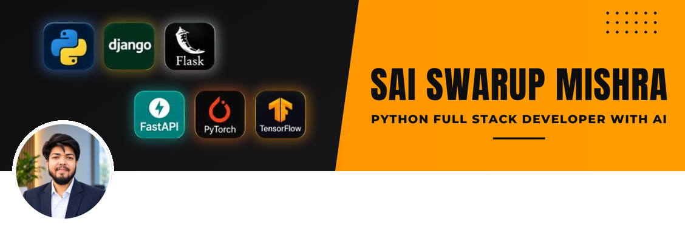

<!-- ===== Animated header ===== -->

<!-- Typing animation -->

  
  
  

# 💫 Hi 👋, I'm Sai Swarup Mishra
**A passionate Python Full Stack Developer || AI/ML Enthusiast || CSE Student**

Open to collaboration, projects and learning together. Feel free to connect with me on GitHub! 😊😊

<!-- Email (optional): Email Me 👉 ✉️ **your-email@gmail.com** -->

## 🚀 About Me

- 🔭 Currently learning **AI / Machine Learning** and **Deep Learning**
- 🛠️ Building full stack web apps with **Python (Django, Flask, FastAPI)**
- 🌱 Exploring **PyTorch** and **TensorFlow**
- 💬 Ask me about **Python, Web Development, AI/ML**
- ⚡ Fun fact: I turn coffee into code ☕➡️💻

## 🔗 Let's Connect 😊

<!-- LinkedIn (optional):  -->

## 🏆 GitHub Trophies

# 💻 Tech Stack:

  

   

## 🏅 My Achievements

# 📊 GitHub Stats:

 

## 📈 Contribution Graph

## 🐍 Contribution Snake

<!-- Needs the snake.yml workflow -> .github/workflows/snake.yml -->

 
<!-- Snake Game Repo View -->

  

## 🌐 Socials:

<!-- LinkedIn / Instagram / X (optional): add your badge here with your own profile link -->

### ✍️ Random Dev Quote

<!-- ===== Animated footer ===== -->

